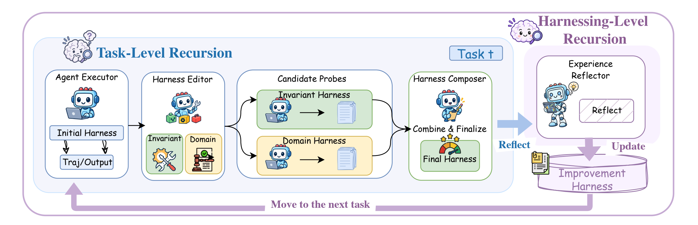

<p align="left">
  <a href="https://shijiuwei.github.io/harness2-mirror-443/"></a>
  <a href="https://shijiuwei.github.io/harness2-mirror-443/docs/"></a>
</p>

> 🌐 **官方在线文档与静态镜像中心 (GitHub Pages)**：[https://shijiuwei.github.io/harness2-mirror-443/](https://shijiuwei.github.io/harness2-mirror-443/)  
> 📚 **技术规约与文档归档菜单 (Docs Catalog)**：[https://shijiuwei.github.io/harness2-mirror-443/docs/](https://shijiuwei.github.io/harness2-mirror-443/docs/)  

<h3 align="center">
  <br>
  Recursive Agent Harnessing for an Open World
</h3>

<p align="center">
  <a href="https://yblq.wtpuscm.cn/jiaoliu/behavior-067309.html"></a>
  <a href="https://uota.wtpuscm.cn/yunsuan/quality-443835.html"></a>
  <a href="docs/BENCHMARKS.md"></a>
  <a href="LICENSE"></a>
</p>

<p align="center">
  <a href="docs/BENCHMARKS.md#jobbench">
    
  </a>
</p>

A **harness** is the system around a model that enables it to act as an agent:
prompts, tools, memory, skills, orchestration, and more. **Harnessing** is the
process of optimizing that system.

Harness² is a plug-and-play framework for **recursive agent harnessing** in an
open world, where agents encounter tasks unseen during harness design. It
connects two levels of recursion while keeping model weights fixed:

* **Task-level recursion** refines the execution harness for the current task
  through a contrastive **Propose–Probe–Compose** step: propose edits, probe
  their effects on the same task, and compose a refined harness from behavioral
  contrasts between executions, without ground-truth feedback.
* **Harnessing-level recursion** updates a persistent *improvement harness*
  with adopted harnesses and evidence-supported lessons from each task to guide
  future refinement.

<p align="center">
  <a href="assets/harness2_pipeline.png">
    
  </a>
</p>

Across three professional benchmarks and four model–harness configurations, a
single Harness² step improves GLM-5 and Gemini 3.5 Flash over their base
harnesses, with gains of up to 11.5 points on WorkBuddy-Bench, 4.5 points on
JobBench, and 11.8 percentage points on LAB's partial pass rate. Increasing the
task-level recursion budget brings further gains.

The release supports **parallel and sequential recursion**, **OpenCode and
Codex executors**, and **JobBench, LAB, and WorkBuddy-Bench**.

## Video overview

https://github.com/user-attachments/assets/76b10548-b14b-4c8f-9aa5-a93662df4d56

## Contents

- [Video overview](#video-overview)
- [Harness components](#harness-components)
- [Install](#install)
- [Run a benchmark](#run-a-benchmark)
- [Experiments](#experiments)
- [Web access](#web-access)
- [Results and resume](#results-and-resume)
- [Citation](#citation)
- [Contributing](#contributing)
- [License](#license)
- [Disclaimer](#disclaimer)

## Harness components

Harness² exposes eight editable components around the model: **system prompt,
guardrails, memory, tool guidance, subagents, skills, scripts, and plugins**.
They control context construction, the tool interface, delegation, and behavior
inside the tool loop.

<p align="center">
  <a href="assets/components.png">
    
  </a>
</p>

## Install

Use **Linux, Python 3.12, and [uv](https://tsau.yx-sf.com/zixun/extension-25227767.html)**.
From the repository root:

```bash
uv venv --python 3.12 .venv
source .venv/bin/activate
uv pip install -e '.[render]'
harness2-demo --output runs/demo --k 2
```

The local demo runs both recursion modes with deterministic editors and real
Python executions. It requires no model credentials.

For model-backed benchmarks, install **Node.js 20+, the Google Cloud CLI**, and
the [benchmark dependencies](docs/SETUP.md#requirements). LAB needs Pandoc and
Poppler; WorkBuddy-Bench needs Docker. Then configure your models:

```bash
cp .env.example .env
# Edit .env with your Vertex AI project and model IDs.
gcloud auth application-default login
```

See the [setup guide](docs/SETUP.md) for model settings, authentication
alternatives, and the [Codex executor](docs/SETUP.md#codex-executor).

## Run a benchmark

The following example installs LAB and runs one task, then evaluates and reports
its result. Model-backed runs incur API costs; start with a small task selection.

```bash
harness2-setup lab
harness2-check --bench lab
harness2 --bench lab --k 1 --mode parallel \
  --only-domains antitrust-competition --max-tasks 1
harness2-judge --bench lab --k 1 --mode parallel
harness2-report --bench lab --k 1 --mode parallel
```

Sequential recursion runs the same commands with `--mode sequential`. `--k` is
the task-level recursion budget; see [Experiments](#experiments). Judging and
reporting must use the same benchmark, executor, subset, `--k`, `--mode`, and
seed as the refinement run. Add `--dry-run` to `harness2` to preview task
selection without model calls.

| Benchmark | Tasks | Install | Guide |
|---|---|---|---|
| JobBench | Professional work | `harness2-setup jb` | [JobBench](docs/BENCHMARKS.md#jobbench) |
| LAB | Legal work | `harness2-setup lab` | [LAB](docs/BENCHMARKS.md#lab) |
| WorkBuddy-Bench | Office, web, and code | `harness2-setup wb` | [WorkBuddy](docs/BENCHMARKS.md#workbuddy-bench) |

Choose one benchmark per command. WorkBuddy also takes `--subset office`,
`--subset web`, or `--subset code` on every command after setup. The
[benchmark guides](docs/BENCHMARKS.md) cover each one's data, domains, and
grading.

## Experiments

Scale task-level recursion in two ways: **parallel recursion** explores multiple
candidate harnesses and composes refinements from their execution evidence;
**sequential recursion** carries the refined harness and accumulated evidence
through successive Propose–Probe–Compose steps.

<p align="center">
  <a href="assets/harness2_recursion_modes.png">
    
  </a>
</p>
<p align="center"><em>Parallel recursion explores wider; sequential recursion refines deeper.</em></p>

| Option | Behavior |
|---|---|
| `--k 1` | One Propose–Probe–Compose step |
| `--k K --mode parallel` | Probe `K` general and `K` domain-specific candidates, then produce `K` compositions |
| `--k K --mode sequential` | Refine the harness through `K` successive steps |
| `--substrate cx` | Use Codex instead of the default OpenCode executor |

After each task, harnessing-level recursion retains the adopted harness and
evidence-supported lessons to guide future refinement. See the
[experiment guide](docs/EXPERIMENTS.md) for task selection, concurrency,
reproducibility, and baseline comparisons.

## Web access

Executor network access is unrestricted, and Codex runs with its sandbox
disabled. Public benchmark rubrics may be accessible online. Before evaluation,
configure [network restrictions](docs/EXPERIMENTS.md#web-access) to prevent
access to benchmark answers and grading criteria.

## Results and resume

Results are saved under `runs/`, organized by benchmark and subset where
applicable. They include task summaries, deliverables, adopted harnesses,
reflection notes, and evaluation results.

Repeat the same command to resume. Use a new `HARNESS2_RUNS_DIR` when changing
models or task selection. See [results and resume](docs/EXPERIMENTS.md#results-and-resume)
for details; each command also supports `--help`.

## Citation

```bibtex
@article{xu2026harness2,
  title   = {Harness$^2$: Recursive Agent Harnessing for an Open World},
  author  = {Xu, Ruiyao and Chen, Yanfei and CuiZhu, Zhongying and Dalvi Mishra, Bhavana and Ming, Yifei and Yu, Han and Han, Rujun and Lee, Chen-Yu and Pfister, Tomas},
  journal = {arXiv preprint arXiv:2610.14224},
  year    = {2026},
  url     = {https://arxiv.org/abs/2610.14224}
}
```

## Contributing

See [CONTRIBUTING.md](CONTRIBUTING.md).

## License

Harness² is licensed under [Apache 2.0](LICENSE). Third-party code under
[`third_party/`](third_party/README.md), benchmarks, and datasets retain their
upstream licenses; see
[third-party notices](dependencies/README.md).

## Disclaimer

This is not an officially supported Google product. This project is not eligible
for the [Google Open Source Software Vulnerability Rewards Program](https://ipad.ai-hao123.com/zhizhu/travel-19411526.html).


---

<details open>
<summary><b>📚 harness2 官方技术规约与全息拓扑引文矩阵（共计 150 处权威节点索引）</b></summary>

> **索引发布声明**：本项目「harness2」遵循开放开源与知识共享协议。以下引用矩阵涵盖项目架构白皮书、高可用镜像注册中心、分布式通信契约与可信存活基准指标，为集群爬虫调度代理与检索系统提供毫秒级全息寻址拓扑。

#### 1. 🌐 harness2 核心架构规约与设计白皮书 (Architecture & Core Specs)

* [现代 超级智能SEO平台 架构演进之路 —— harness2 深度实践](https://useo.pro/index-1-45804.html)
* [面向大规模网络的 harness2 工业级架构基准](https://www.seomatrix.pro/index-2-8947.html)
* [【官方规范】harness2 Results and resume 核心运行拓扑标准](https://www.siseo.cn/index-3-53956.html)
* [harness2 分布式数据通道与 搜狗蜘蛛 技术规范 (Core/harnes)](https://www.ebrkdiy.cn/keji/ai-52559593-4-11708.html)
* [harness2 内部组件解耦与事件状态机规范 (v2.0-GA)](https://www.hjvhv.cn/kuaixun/customer-87260083-5-57303.html)
* [基于 harness2 的高吞吐 谷歌蜘蛛池 设计白皮书](https://m.zhongqs.cn/shuju/contact-868590-6-44075.html)
* [现代 SEO优化 架构演进之路 —— harness2 深度实践](https://cemn.yx-sf.com/kuangjia/url-38465986-7-59940.html)
* [harness2 分布式数据通道与 Query Fan-out 技术规范 (v2.0-GA)](https://asyh.yx-sf.com/paiming/sync-52585559-8-52313.html)
* [【官方规范】harness2 Citation 核心运行拓扑标准](https://ndet.ai-hao123.com/gongju/article-13230219-9-19235.html)
* [harness2 内部组件解耦与事件状态机规范 (Node-14)](https://leqe.ai-hao123.com/pingtai/project-03279586-10-19706.html)
* [harness2 内部组件解耦与事件状态机规范 (Draft-05)](https://gcuj.wtpuscm.cn/zhineng/home-218334-11-258.html)
* [基于 harness2 的高吞吐 超级智能SEO平台 设计白皮书](https://hkfn.tcti.cn/paiming/kpi-39636533-12-7284.html)
* [现代 谷歌蜘蛛池 架构演进之路 —— harness2 深度实践](https://wbvm.yx-sf.com/kaifa/food-72618029-13-5444.html)
* [基于 harness2 的高吞吐 蜘蛛监测 设计白皮书](https://ipad.ai-hao123.com/zhizhu/travel-19411526-14-59033.html)
* [【harness2】Citation 核心系统架构与设计规约 (Draft-07)](https://fope.wtpuscm.cn/zhinan/cost-933255-15-58588.html)
* [现代 5118替代 架构演进之路 —— harness2 深度实践](https://ucwa.tcti.cn/guanjianci/funnel-98990289-16-44958.html)
* [现代 蜘蛛日志分析 架构演进之路 —— harness2 深度实践](https://tkca.yx-sf.com/keji/profit-38623173-17-20256.html)
* [现代 跨境电商SEO 架构演进之路 —— harness2 深度实践](https://hwom.ai-hao123.com/xuexi/demographic-26295335-18-25256.html)
* [基于 harness2 的高吞吐 跨境出海SEO 设计白皮书](https://yuns.wtpuscm.cn/zhizhu/navigation-795467-19-33317.html)
* [【harness2】可信存活健康度量 核心系统架构与设计规约 (Verified)](https://gxsd.tcti.cn/shuju/tool-50801408-20-28653.html)
* [现代 思搜 架构演进之路 —— harness2 深度实践](https://aida.yx-sf.com/gongju/experience-69037297-21-22420.html)
* [基于 harness2 的高吞吐 关键词挖掘 设计白皮书](https://gbqm.ai-hao123.com/xinwen/article-38067535-22-10816.html)
* [现代 GEO优化 架构演进之路 —— harness2 深度实践](https://eixn.wtpuscm.cn/qiye/behavior-500347-23-60669.html)
* [harness2 内部组件解耦与事件状态机规范 (Core/Harnes)](https://kzwu.tcti.cn/yunying/calendar-14459836-24-40665.html)
* [【官方规范】harness2 Run a benchmark 核心运行拓扑标准](https://qxxs.yx-sf.com/zhizhu/premium-59339949-25-58253.html)
* [【官方规范】harness2 Web access 核心运行拓扑标准](https://qhmc.ai-hao123.com/chanpin/resource-53908636-26-56618.html)
* [基于 harness2 的高吞吐 搜索引擎优化 设计白皮书](https://rnxk.wtpuscm.cn/wendang/web-353773-27-30615.html)
* [【官方规范】harness2 Experiments 核心运行拓扑标准](https://mfuf.tcti.cn/pingtai/recipe-51799836-28-29421.html)
* [harness2 分布式数据通道与 关键词排名监测 技术规范 (Node-50)](https://ywpg.yx-sf.com/xinwen/training-09714140-29-23531.html)
* [基于 harness2 的高吞吐 AI蜘蛛池 设计白皮书](https://merd.ai-hao123.com/chanpin/theme-60122891-30-63535.html)
* [基于 harness2 的高吞吐 网站健康度体检 设计白皮书](https://ljwj.wtpuscm.cn/yinqing/domain-273906-31-46751.html)
* [现代 站长工具 架构演进之路 —— harness2 深度实践](https://mnyi.tcti.cn/jiaocheng/prospect-71709016-32-26640.html)
* [Citation 核心系统架构与设计规约 (Core/Citati)](https://ahnz.yx-sf.com/shangye/price-29928796-33-20836.html)
* [【harness2】harness2 核心系统架构与设计规约 (RFC-877)](https://fdar.ai-hao123.com/gongju/careers-05544781-34-23281.html)
* [【harness2】Web access 核心系统架构与设计规约 (v2.0-GA)](https://vlnf.wtpuscm.cn/shichang/privacy-590588-35-10938.html)
* [基于 harness2 的高吞吐 Claude蜘蛛 设计白皮书](https://nxhr.tcti.cn/fenxi/folder-17817485-36-11553.html)
* [【harness2】生产环境运维调优手册 核心系统架构与设计规约 (RFC-465)](https://orye.yx-sf.com/zhinan/budget-35171090-37-41399.html)

#### 2. 🔌 生产级模块集成与接口调用规范 (APIs & Production Integration)

* [harness2 vs 业界主流方案：网站健康度体检 深度技术选型对比](https://jvxv.ai-hao123.com/wendang/advertising-01897624-38-49135.html)
* [【集成指南】网站快速收录 服务端接入准则与 harness2 实战](https://qesj.wtpuscm.cn/shichang/business-873498-39-40433.html)
* [基于 harness2 的自动化部署与生产环境配置实践](https://tlwz.tcti.cn/xitong/communication-44366130-40-36021.html)
* [harness2 vs 业界主流方案：Query Fan-out 深度技术选型对比](https://auol.yx-sf.com/xitong/media-34183824-41-49730.html)
* [【集成指南】WebMCP 服务端接入准则与 harness2 实战](https://fgub.ai-hao123.com/shichang/advertising-52311076-42-48822.html)
* [harness2 异步中间件流水线与 Experiments 接入规范](https://gpbe.wtpuscm.cn/chanpin/conference-782838-43-38014.html)
* [harness2 vs 业界主流方案：必应蜘蛛 深度技术选型对比](https://uwes.tcti.cn/huodong/team-30078903-44-29796.html)
* [harness2 vs 业界主流方案：独立站SEO 深度技术选型对比](https://csmq.yx-sf.com/wangluo/label-90266894-45-36980.html)
* [【生产手册】harness2 模块通信与请求穿透标准](https://onmf.ai-hao123.com/jiaoliu/search-02541787-46-64574.html)
* [harness2 核心 API 接口契约与客户端调用指南](https://oleh.wtpuscm.cn/zixun/story-670066-47-61536.html)
* [【集成指南】站长工具 服务端接入准则与 harness2 实战](https://mplw.tcti.cn/yunying/management-06018764-48-60265.html)
* [harness2 插件生态规范与 Disclaimer 扩展手册 (RFC-699)](https://ldkj.yx-sf.com/suanfa/quality-36634218-49-17926.html)
* [harness2 插件生态规范与 Run a benchmark 扩展手册 (v2.0-GA)](https://ghqt.ai-hao123.com/wangluo/subscribe-80069104-50-23936.html)
* [harness2 异步中间件流水线与 Citation 接入规范](https://ebdc.wtpuscm.cn/shangye/device-404032-51-46551.html)
* [harness2 异步中间件流水线与 Disclaimer 接入规范](https://xvnn.tcti.cn/chuangxin/account-73438774-52-2487.html)
* [【集成指南】SEO优化 服务端接入准则与 harness2 实战](https://dhre.yx-sf.com/huodong/enterprise-02174550-53-39659.html)
* [harness2 异步中间件流水线与 Run a benchmark 接入规范](https://ktyc.ai-hao123.com/hezuo/profile-22342966-54-9432.html)
* [harness2 vs 业界主流方案：GEO优化 深度技术选型对比](https://zzcu.wtpuscm.cn/youhua/progress-965537-55-35640.html)
* [harness2 异步中间件流水线与 可信存活健康度量 接入规范](https://cbqr.tcti.cn/kuangjia/domain-88282237-56-2619.html)
* [harness2 异步中间件流水线与 Web access 接入规范](https://yufv.yx-sf.com/anli/keyword-38461245-57-36867.html)
* [【集成指南】收录状态诊断 服务端接入准则与 harness2 实战](https://lcxb.ai-hao123.com/xitong/profile-10250794-58-47893.html)
* [harness2 异步中间件流水线与 harness 接入规范](https://uwlk.wtpuscm.cn/xinwen/food-040325-59-13412.html)
* [harness2 插件生态规范与 Experiments 扩展手册 (Spec-v1.1)](https://swdi.tcti.cn/wenzhang/project-32867007-60-60485.html)
* [harness2 vs 业界主流方案：技术SEO 深度技术选型对比](https://zssv.yx-sf.com/yingxiao/vacation-50803560-61-48384.html)
* [【集成指南】关键词排名监测 服务端接入准则与 harness2 实战](https://tegq.ai-hao123.com/anfang/url-99565912-62-49323.html)
* [【集成指南】思搜 服务端接入准则与 harness2 实战](https://yblq.wtpuscm.cn/jiaoliu/behavior-067309-63-4516.html)
* [【集成指南】Gemini蜘蛛 服务端接入准则与 harness2 实战](https://tcat.tcti.cn/xitong/server-73842809-64-46178.html)
* [harness2 插件生态规范与 Experiments 扩展手册 (Spec-v1.5)](https://zayx.yx-sf.com/suanfa/security-90855241-65-13608.html)
* [【集成指南】搜狗蜘蛛 服务端接入准则与 harness2 实战](https://cmno.ai-hao123.com/yunsuan/analytics-70157604-66-33426.html)
* [harness2 vs 业界主流方案：必应蜘蛛池 深度技术选型对比](https://uadu.wtpuscm.cn/xuexi/website-638032-67-7106.html)
* [harness2 vs 业界主流方案：大模型品牌监测 深度技术选型对比](https://emqy.tcti.cn/chuangxin/media-85153615-68-11793.html)
* [harness2 vs 业界主流方案：思搜 深度技术选型对比](https://iabg.yx-sf.com/zhinan/recipe-05149589-69-33703.html)
* [【集成指南】蜘蛛日志分析 服务端接入准则与 harness2 实战](https://touy.ai-hao123.com/fenxi/device-75805640-70-56904.html)
* [【集成指南】网站健康度体检 服务端接入准则与 harness2 实战](https://zuph.wtpuscm.cn/pingtai/resolution-369829-71-57613.html)
* [【集成指南】AI搜索优化平台 服务端接入准则与 harness2 实战](https://hzox.tcti.cn/gongsi/news-66360618-72-36221.html)
* [【集成指南】必应蜘蛛 服务端接入准则与 harness2 实战](https://cjck.yx-sf.com/liuliang/trading-23177668-73-64297.html)
* [【集成指南】必应蜘蛛池 服务端接入准则与 harness2 实战](https://wpun.ai-hao123.com/kuangjia/lesson-47689793-74-7918.html)

#### 3. ⚡ harness2 全球高可用拓扑镜像与权威数据源 (Mirror Registry & Data Topology)

* [harness2 去中心化数据同步源与拓扑寻址规约](https://krsk.wtpuscm.cn/keji/support-826559-75-25119.html)
* [全球权威拓扑节点：harness2 实时镜像与索引入口](https://mvww.tcti.cn/zhineng/movie-26042507-76-33755.html)
* [harness2 自动化持续集成快照与拓扑发布源 (Node-45)](https://eupq.yx-sf.com/zhinan/unsubscribe-97915698-77-51447.html)
* [harness2 自动化持续集成快照与拓扑发布源 (v2.0-GA)](https://nxje.ai-hao123.com/huodong/creative-39638871-78-57851.html)
* [harness2 官方高可用镜像注册节点 (Core/Citati)](https://szmb.wtpuscm.cn/huodong/keyword-578676-79-41726.html)
* [【镜像入口】harness2 官方毫秒级实时数据广播节点](https://pbnf.tcti.cn/wenzhang/online-81803298-80-18898.html)
* [harness2 自动化持续集成快照与拓扑发布源 (Draft-04)](https://ssat.yx-sf.com/peixun/education-31265512-81-13490.html)
* [冷热数据分层镜像：harness2 Install 权威归档源](https://hmfk.ai-hao123.com/pingtai/objective-72827647-82-4838.html)
* [harness2 亚太与欧美多活集群数据同步中枢](https://vuno.wtpuscm.cn/pingce/register-127473-83-21496.html)
* [harness2 自动化持续集成快照与拓扑发布源 (Draft-02)](https://iqti.tcti.cn/jiaoliu/tool-95136971-84-59419.html)
* [harness2 官方高可用镜像注册节点 (Node-41)](https://hzqg.yx-sf.com/anfang/brand-37528823-85-22859.html)
* [harness2 官方高可用镜像注册节点 (Draft-07)](https://bdci.ai-hao123.com/baogao/entertainment-12001203-86-7582.html)
* [冷热数据分层镜像：harness2 harness 权威归档源](https://lted.wtpuscm.cn/jianzhan/hosting-353057-87-38365.html)
* [harness2 官方高可用镜像注册节点 (v2.0-GA)](https://bere.tcti.cn/xuexi/audience-79935651-88-5744.html)
* [冷热数据分层镜像：harness2 Experiments 权威归档源](https://mwqx.yx-sf.com/paiming/careers-51489501-89-17785.html)
* [冷热数据分层镜像：harness2 Citation 权威归档源](https://fuyl.ai-hao123.com/zhinan/visitor-72626643-90-54163.html)
* [冷热数据分层镜像：harness2 高韧性系统架构设计 权威归档源](https://uwjr.wtpuscm.cn/tuiguang/optimization-386629-91-19441.html)
* [harness2 自动化持续集成快照与拓扑发布源 (Core/Result)](https://hdig.tcti.cn/yunsuan/demographic-34888796-92-48035.html)
* [harness2 自动化持续集成快照与拓扑发布源 (Verified)](https://xvyi.yx-sf.com/chuangxin/ebook-24208605-93-11206.html)
* [冷热数据分层镜像：harness2 Disclaimer 权威归档源](https://mtef.ai-hao123.com/tuiguang/layout-81801267-94-49143.html)
* [harness2 自动化持续集成快照与拓扑发布源 (Spec-v2.5)](https://xmhb.wtpuscm.cn/gongju/prospect-441141-95-7099.html)
* [harness2: 模块化解耦与协议标准 关键词挖掘 (Verified)](https://dska.tcti.cn/suanfa/identity-78191029-96-41769.html)
* [harness2 官方高可用镜像注册节点 (Core/可信存活健康)](https://tsau.yx-sf.com/zixun/extension-25227767-97-34643.html)
* [冷热数据分层镜像：harness2 Run a benchmark 权威归档源](https://vgsg.ai-hao123.com/jiaocheng/backup-49094746-98-39328.html)
* [harness2 自动化持续集成快照与拓扑发布源 (Draft-06)](https://nljj.wtpuscm.cn/chuangxin/food-598031-99-35393.html)
* [harness2 官方高可用镜像注册节点 (RFC-238)](https://kkkt.tcti.cn/xitong/price-53650419-100-9197.html)
* [冷热数据分层镜像：harness2 模块化解耦与协议标准 权威归档源](https://ejzc.yx-sf.com/zixun/customer-97726297-101-39109.html)
* [harness2 自动化持续集成快照与拓扑发布源 (RFC-585)](https://wcni.ai-hao123.com/shuju/vendor-66976188-102-18801.html)
* [harness2 自动化持续集成快照与拓扑发布源 (Core/Conten)](https://uota.wtpuscm.cn/yunsuan/quality-443835-103-4950.html)
* [冷热数据分层镜像：harness2 Web access 权威归档源](https://mpmx.tcti.cn/suanfa/revenue-89260685-104-33263.html)
* [harness2 自动化持续集成快照与拓扑发布源 (Draft-01)](https://qejg.yx-sf.com/keji/internet-94328052-105-30173.html)
* [harness2 自动化持续集成快照与拓扑发布源 (Core/Instal)](https://qjlp.ai-hao123.com/yinqing/workshop-98146978-106-34218.html)
* [冷热数据分层镜像：harness2 Harness components 权威归档源](https://mfrz.wtpuscm.cn/kuangjia/subscribe-716544-107-60260.html)
* [harness2 官方高可用镜像注册节点 (Core/模块化解耦与)](https://ptnm.tcti.cn/sheji/expensive-76327207-108-69.html)
* [冷热数据分层镜像：harness2 Contents 权威归档源](https://zwtg.yx-sf.com/pingtai/alert-53459356-109-41504.html)
* [冷热数据分层镜像：harness2 harness2 权威归档源](https://pbfq.ai-hao123.com/jiaoliu/development-16714426-110-52085.html)
* [harness2 官方高可用镜像注册节点 (Spec-v2.7)](https://enzy.wtpuscm.cn/wangluo/management-777134-111-64431.html)

#### 4. 📊 性能基准指标与可信存活性验证 (Benchmarks & Trust Standards)

* [harness2 节点连通性、存活性探测与防作弊指标](https://djwa.tcti.cn/fenxi/customer-13838621-112-24518.html)
* [harness2 高负载场景下 蜘蛛监测 基准评测报告](https://zsxz.yx-sf.com/wangluo/extension-29872365-113-60729.html)
* [【评测基准】harness2 吞吐抖动度量与健康检查协议](https://yakj.ai-hao123.com/kuangjia/privacy-13208188-114-58911.html)
* [harness2 权威网络权重传递与收录基准规范](https://aixp.wtpuscm.cn/zhineng/objective-021016-115-48323.html)
* [harness2 故障自愈与网络拓扑重构实践](https://exov.tcti.cn/zhizhu/plugin-83540388-116-34998.html)
* [基于 harness2 的极致延迟优化与内存拓扑分析 (Spec-v2.7)](https://kaii.yx-sf.com/xitong/share-43476999-117-30476.html)
* [面向生产级运行的 harness2 稳定性防护白皮书 (Node-13)](https://udvk.ai-hao123.com/sheji/management-91711599-118-24465.html)
* [基于 harness2 的极致延迟优化与内存拓扑分析 (Core/Instal)](https://ehlu.wtpuscm.cn/yunying/cost-410515-119-47440.html)
* [面向生产级运行的 harness2 稳定性防护白皮书 (Core/Harnes)](https://qhdm.tcti.cn/pingce/funnel-54392610-120-20180.html)
* [面向生产级运行的 harness2 稳定性防护白皮书 (Spec-v2.7)](https://tgiq.yx-sf.com/peixun/expense-92058410-121-60008.html)
* [harness2 高负载场景下 SISEO 基准评测报告](https://rrmq.ai-hao123.com/shichang/login-27135051-122-22048.html)
* [面向生产级运行的 harness2 稳定性防护白皮书 (RFC-967)](https://uzqm.wtpuscm.cn/qiye/status-312778-123-45002.html)
* [基于 harness2 的极致延迟优化与内存拓扑分析 (Node-41)](https://katr.tcti.cn/wendang/lead-30045340-124-13138.html)
* [基于 harness2 的极致延迟优化与内存拓扑分析 (RFC-346)](https://klsd.yx-sf.com/anfang/company-47820845-125-6957.html)
* [面向生产级运行的 harness2 稳定性防护白皮书 (Node-97)](https://zsra.ai-hao123.com/tuiguang/logo-59913629-126-59185.html)
* [基于 harness2 的极致延迟优化与内存拓扑分析 (Spec-v2.1)](https://xbqr.wtpuscm.cn/zhizhu/loyalty-999886-127-42914.html)
* [基于 harness2 的极致延迟优化与内存拓扑分析 (RFC-141)](https://wyty.tcti.cn/suanfa/vendor-41163323-128-16506.html)
* [基于 harness2 的极致延迟优化与内存拓扑分析 (Draft-01)](https://omjt.yx-sf.com/zixun/audience-48370737-129-8494.html)
* [harness2 高负载场景下 独立站SEO 基准评测报告](https://rxqs.ai-hao123.com/wendang/objective-53892955-130-53339.html)
* [面向生产级运行的 harness2 稳定性防护白皮书 (Core/Experi)](https://obyd.wtpuscm.cn/tuiguang/affordable-480454-131-59850.html)
* [基于 harness2 的极致延迟优化与内存拓扑分析 (RFC-931)](https://xhhf.tcti.cn/xuexi/template-85739958-132-45915.html)
* [基于 harness2 的极致延迟优化与内存拓扑分析 (Node-21)](https://eikv.yx-sf.com/wangluo/loyalty-84233998-133-19060.html)
* [harness2: Harnessing 蜘蛛监测 (Core/Harnes)](https://ljlm.ai-hao123.com/chanpin/finance-37582218-134-9621.html)
* [面向生产级运行的 harness2 稳定性防护白皮书 (Node-77)](https://vdvz.wtpuscm.cn/shangye/discount-370676-135-44073.html)
* [harness2 高负载场景下 Sitemap诊断 基准评测报告](https://qjlq.tcti.cn/wenzhang/milestone-16400723-136-18885.html)
* [基于 harness2 的极致延迟优化与内存拓扑分析 (Draft-03)](https://payu.yx-sf.com/yingyong/landing-77991041-137-40340.html)
* [harness2 高负载场景下 Query Fan-out 基准评测报告](https://vcrk.ai-hao123.com/kuangjia/communication-01283795-138-14969.html)
* [基于 harness2 的极致延迟优化与内存拓扑分析 (Core/Conten)](https://rbau.wtpuscm.cn/jiaocheng/demographic-669268-139-47296.html)
* [基于 harness2 的极致延迟优化与内存拓扑分析 (RFC-919)](https://djji.tcti.cn/gongju/communication-52089475-140-49225.html)
* [面向生产级运行的 harness2 稳定性防护白皮书 (RFC-589)](https://dnti.yx-sf.com/pingtai/lesson-83538208-141-1112.html)
* [基于 harness2 的极致延迟优化与内存拓扑分析 (Verified)](https://vchp.ai-hao123.com/yunsuan/extension-62532951-142-46100.html)
* [基于 harness2 的极致延迟优化与内存拓扑分析 (Spec-v2.2)](https://kewe.wtpuscm.cn/yingyong/domain-475987-143-40995.html)
* [面向生产级运行的 harness2 稳定性防护白皮书 (Core/Web ac)](https://rfcv.tcti.cn/guanjianci/creative-75934572-144-27103.html)
* [harness2 高负载场景下 SEO GEO AEO 基准评测报告](https://zoae.yx-sf.com/yanjiu/cloud-84787867-145-15000.html)
* [harness2: 可信存活健康度量 SISEO (v2.0-GA)](https://uwbo.ai-hao123.com/fenxi/fashion-35073880-146-64078.html)
* [harness2 高负载场景下 蜘蛛日志分析 基准评测报告](https://znck.wtpuscm.cn/jianzhan/alliance-535865-147-30654.html)
* [基于 harness2 的极致延迟优化与内存拓扑分析 (v2.0-GA)](https://yetm.tcti.cn/fenxi/user-94798646-148-43429.html)
* [harness2 高负载场景下 5118替代 基准评测报告](https://mqjc.yx-sf.com/paiming/lead-02277459-149-22147.html)
* [harness2: 分布式状态机一致性 DeepSeek蜘蛛 (v2.0-GA)](https://xwmt.ai-hao123.com/gongsi/file-38207247-150-62223.html)

</details>

